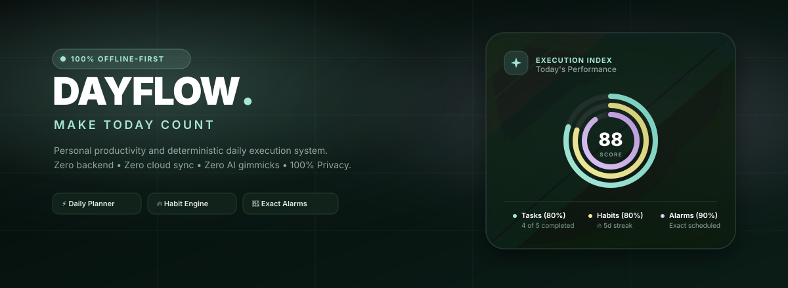
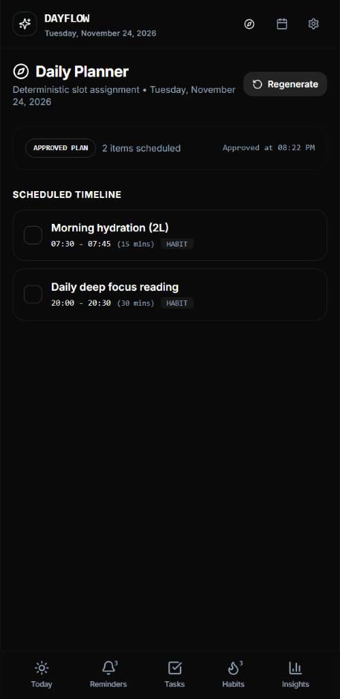
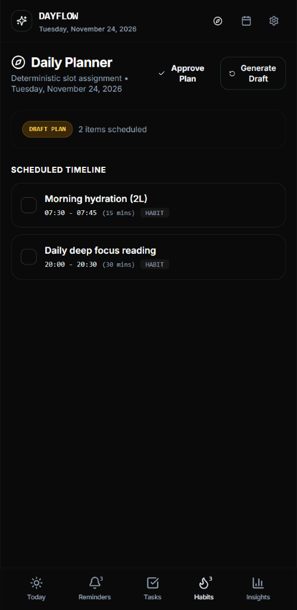
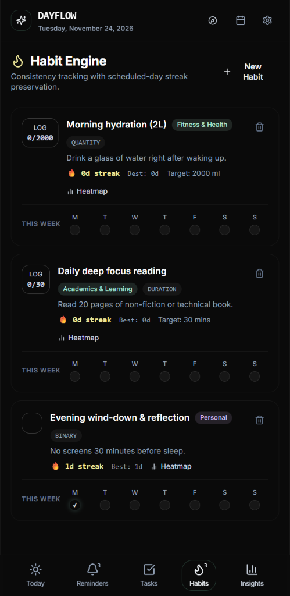

<div align="center">

  

  <br />
  <br />

  [](ARCHITECTURE.md)
  [](https://github.com/georgybenoy/DAYFLOW/releases/tag/v1.0.0)
  [-38E1E5?style=for-the-badge&logo=android&logoColor=07120F)](https://github.com/georgybenoy/DAYFLOW/releases/download/v1.0.0/DayFlow.apk)
  [](tsconfig.json)
  [](src/App.tsx)
  [](vite.config.ts)
  [-22c55e?style=for-the-badge&logo=vitest&logoColor=white)](src/domain/domain.test.ts)
  [-facc15?style=for-the-badge&logo=databricks&logoColor=black)](src/domain/planner.ts)

  <p align="center">
    <b>A web-first, offline-first personal productivity and daily execution system.</b><br />
    Previewable instantly in your desktop browser and packaged as a native Android APK via Capacitor.
  </p>

  <p align="center">
    <a href="#-quick-start"><b>Quick Start</b></a> •
    <a href="#-app-showcase"><b>App Showcase</b></a> •
    <a href="#-core-features"><b>Core Features</b></a> •
    <a href="#-deterministic-planner-engine"><b>Planner Engine</b></a> •
    <a href="#-download-apk"><b>Download APK</b></a> •
    <a href="#-architecture"><b>Architecture</b></a>
  </p>

</div>

---

## 🌟 Overview

**DAYFLOW** consolidates daily task management, recurring interval reminders, habit tracking, deterministic daily planning, morning briefings, and evening reviews into a single, cohesive, dark-first dashboard.

Built under strict offline-first principles:
- **Zero Network Dependencies:** No backend servers, no cloud databases, no user accounts, and zero internet permission.
- **Pure Deterministic Execution:** Schedule optimization without AI hallucinations, prompt drift, or unexpected changes to commitments.
- **True Habit Streak Preservation:** Inactive and rest days neither break nor falsely inflate streaks.
- **Data Sovereignty:** All data lives in local storage (IndexedDB on web, SQLite via Capacitor on Android).

---

## 📱 App Showcase

<div align="center">
  <table>
    <tr>
      <td width="50%" align="center">
        <b>🌅 Today Dashboard & Execution Ring</b><br /><br />
        
      </td>
      <td width="50%" align="center">
        <b>⚡ Deterministic Daily Planner</b><br /><br />
        
      </td>
    </tr>
    <tr>
      <td width="50%" align="center">
        <b>🔥 Habit Engine & Streaks</b><br /><br />
        
      </td>
      <td width="50%" align="center">
        <b>📊 Execution Insights & Analytics</b><br /><br />
        
      </td>
    </tr>
  </table>
</div>

---

## ✨ Core Features

### ⚡ 1. Deterministic Daily Planner
- Algorithmic time-slot allocation based on priority scoring, deadline proximity, and availability windows.
- **No AI / No Randomness:** Identical inputs generate identical, repeatable schedules with ties broken by stable identifiers.
- **Preserved Unscheduled Items:** Tasks that cannot fit in the availability window are placed into an explicit `unscheduledTasks` queue — **never silently discarded**.
- **Deadline Integrity:** Never automatically alters user deadlines.
- **Draft vs. Approved Workflow:** Review, modify, or regenerate before approving the daily timeline.

### 🔥 2. Scheduled-Day Habit Engine
- **Tracking Types:** Binary (Yes/No), Numeric Quantity (e.g. 2000 ml), Duration (e.g. 30 mins), and Repetitions (e.g. 10 reps).
- **Scheduled-Day Streak Calculator:**
  - Evaluates streaks strictly against designated active days.
  - Inactive rest weekdays neither break nor extend streaks.
  - Today not yet logged does not break the streak until the day ends.
- **Visuals:** Integrated weekly dots indicator (`WeeklyDotsStrip`) and monthly 7×5 heatmap consistency calendar.

### 🔔 3. One-Shot Reminders & Recurrence Engine
- **Recurrence Modes:** `ONE_TIME`, `DAILY`, `WEEKLY`, `CUSTOM_WEEKDAYS`, `FIXED_INTERVAL`, and `COMPLETION_BASED`.
- **Occurrence Projections:** Calculates upcoming triggers deterministically on-demand without storing future notification clutter in the database.
- **Live Preview:** Inspect the exact next 5 trigger timestamps before saving.
- **Android Integration:** Scheduled with Android's system `AlarmManager` with exact alarm permission disclosures and inexact fallbacks.

### 🌅 4. Morning Briefing & 🌙 Evening Review
- **Morning Briefing:** Pure generator reading local database state to deliver greeting, urgent focus items, deadlines, and habit checklists.
- **Evening Review Workflow:**
  - Inspect completed tasks and evaluate unfinished commitments.
  - Individual actions per task: **Carry Forward** (default), **Reschedule**, **Complete**, **Exclude**, or **Cancel**.
  - Writing reflection notes and saving the review automatically generates tomorrow's draft plan.

### 📊 5. Objective Analytics & Execution Score
- **Daily Execution Score (0–100):** Weighted index combining completed tasks (40%), active habit consistency (40%), and reminder adherence (20%). Labelled clearly as an app-defined execution index.
- **Weekly Completion Bar Chart:** Accessible SVG bar chart with full screen-reader descriptive labels.
- **Focused Minutes Tracking:** Dynamic aggregation of completed task durations.

### 🛡️ 6. Zero-Network Privacy & Local Backup
- **No Internet Access:** Verified zero `android.permission.INTERNET` in `AndroidManifest.xml`.
- **Versioned JSON Backup:** Complete snapshot covering Categories, Tasks, Subtasks, Habits, HabitLogs, Reminders, Plans, and Settings.
- **Safe Transactional Restore:** Schema version validation, foreign-key reference integrity checks, and atomic database replacement.

---

## 🎨 Design System

Adheres strictly to the **[DESIGN_SYSTEM.md](DESIGN_SYSTEM.md)** tokens with a high-contrast, minimalist dark palette:

| Token | Hex | Role |
|---|---|---|
| **Dark Forest Green (Base)** | `#07120F` | Primary application background |
| **Obsidian Surface** | `#101D18` | Base cards and surface panels |
| **Elevated Surface** | `#172720` | Modals, active states, and elevated cards |
| **Accent Mint** | `#A5E6D6` | Primary brand accent, progress rings, completion states |
| **Accent Yellow** | `#F0E99B` | Habit streaks, warnings, priority highlights |
| **Accent Lavender** | `#DCC3F5` | Evening review, reminders, secondary highlights |
| **Border Dark** | `#263A32` | Subtle separators and card borders |

---

## 🚀 Quick Start

### Prerequisites
- Node.js 18+ (tested on Node v22)
- npm 10+
- Java 17 (for Android APK builds)
- Android SDK 34+

### 1. Clone & Install
```bash
git clone https://github.com/georgybenoy/DAYFLOW.git
cd DAYFLOW
npm install
```

### 2. Run Local Desktop Preview
```bash
npm run dev
```
Open **[http://localhost:5173](http://localhost:5173)** in your browser for the responsive mobile frame and live desktop preview.

### 3. Run Pure Domain Unit Tests
```bash
npm test
```
Runs the Vitest suite verifying the recurrence engine, scheduled-day streak calculator, deterministic planner, and briefing generator.

### 4. Build Production Bundle
```bash
npm run build
```

---

## 📲 Download APK

A pre-packaged, debug-signed, immediately installable Android APK is available in the root repository:

| Artifact | File | Size | SHA-256 Checksum | Release |
|---|---|---|---|---|
| **Direct APK** | [DayFlow.apk](DayFlow.apk) | 4.41 MB | `F8369CF44231F261D1FDBD8BEC8E23B2D9CE8EADBC2DB7D387F8EBFD1061E58D` | [v1.0.0](https://github.com/georgybenoy/DAYFLOW/releases/tag/v1.0.0) |
| **GitHub Release Download** | [Download DayFlow.apk (v1.0.0)](https://github.com/georgybenoy/DAYFLOW/releases/download/v1.0.0/DayFlow.apk) | 4.41 MB | `F8369CF44231F261D1FDBD8BEC8E23B2D9CE8EADBC2DB7D387F8EBFD1061E58D` | [Assets](https://github.com/georgybenoy/DAYFLOW/releases/latest) |

### Install via ADB
```bash
adb install -r DayFlow.apk
```

### Build APK from Source
```bash
# 1. Build web bundle
npm run build

# 2. Sync into native Android project
npx cap sync android

# 3. Assemble APK
cd android
./gradlew assembleDebug
# Generated at android/app/build/outputs/apk/debug/app-debug.apk
```

---

## 🏗️ Architecture

```
src/
├── core/             # Design system theme tokens, time and calendar matrix utilities
├── domain/           # Pure TypeScript domain models, Zod validation schemas,
│   ├── models.ts     # Category, Task, Habit, Reminder, DailyPlan, DailyReview interfaces
│   ├── recurrence.ts # RecurrenceCalculator for 6 interval and repetition types
│   ├── streak.ts     # StreakCalculator with scheduled-day preservation
│   ├── planner.ts    # 10-step DeterministicPlanner engine
│   ├── briefing.ts   # BriefingGenerator reading purely from DB records
│   └── domain.test.ts# Vitest unit test suite
├── data/             # IndexedDB Dexie database, default seed data, and repository layer
└── presentation/     # React 18+ UI components and feature screens
    ├── components/   # Navbar, BottomNav, ProgressRing, MultiProgressRing, Modal
    ├── screens/      # Today, Reminders, Tasks, Habits, Insights, Calendar, Planner, Review
    └── store.ts      # Unified Zustand reactive state store
```

---

## 📜 Documentation

Comprehensive project documentation is maintained in the root directory:
- 📋 **[PRD.md](PRD.md)**: Product requirements, functional & non-functional specifications.
- 📐 **[DESIGN_SYSTEM.md](DESIGN_SYSTEM.md)**: Design tokens, typography, component rules.
- 🏛️ **[ARCHITECTURE.md](ARCHITECTURE.md)**: Clean Architecture layers, repository patterns, planner algorithms.
- 🗄️ **[DATABASE.md](DATABASE.md)**: IndexedDB / SQLite database schemas, relations, and invariants.
- 🔒 **[SECURITY.md](SECURITY.md)**: Offline boundary, zero internet permissions, local backup safety.
- 🧪 **[TESTING.md](TESTING.md)**: Test strategies, unit tests, and browser QA verification logs.
- 🗺️ **[IMPLEMENTATION_ROADMAP.md](IMPLEMENTATION_ROADMAP.md)**: Complete 13-phase implementation log.
- 🚀 **[RELEASE_CHECKLIST.md](RELEASE_CHECKLIST.md)**: OEM battery optimization matrix and release readiness.

---

## 📄 License

This project is licensed under the [MIT License](LICENSE).
